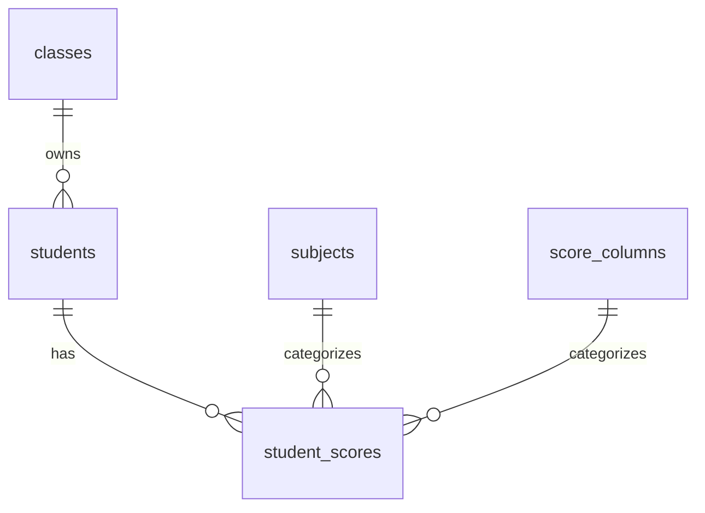

# CP01-A — Database and security technical design

**Design date:** 2026-10-26. **Business authority:** [BRIEF V1.2](BRIEF.md), including the two/three-header clarification. **Input HEAD:** `f522266888540bf0912c727ad38d1f6b7e237a17`, branch `feature/personal-gradebook`. This is a design, not executable SQL, an applied migration, a deployed API or security acceptance. CP01-B/CP01-C and the [real-data gate](DATA_AND_SECURITY.md#h-real-personal-data-gate) need separate authorization/evidence.

**Accepted refinement baseline:** `31f887bd3c21303d56fe429408f8dd0d1e69ba0c`, 2026-10-26; GB-A-REV-001..003 are corrected in documentation below. Local/remote matched that SHA; feature ahead 5/behind 1 versus develop `307b6c6`, no newer remote commits or merge/rebase. Environment facts in §1.1 remain the original inspection snapshot, not a new Supabase inspection. CP01-B NOT STARTED; CP01-C and real-data acceptance NOT RUN.

Business rules remain in BRIEF. Current import semantics follow V1.2 / GB-B1-REV-003; earlier design verification snapshots below did not test this correction. This document resolves technical implementation choices under [DATA_AND_SECURITY](DATA_AND_SECURITY.md); runtime limits and crypto/API details below are technical defaults to test, not new approved product features.

## 1. Architecture overview

Browser → two Supabase Edge Functions → narrow server-only PostgREST RPCs → six tables in non-exposed `gradebook`. No new Node server, ORM, student Auth accounts, paid service or generic transaction/config framework. `grades-admin` verifies the existing teacher; `student-lookup` verifies the identifier pair or an encrypted short-lived capability. All client table access to Gradebook is denied. The existing board keeps its current Supabase client, RPCs and policies.

### 1.1 Verified environment and limits of verification

Read-only connector/catalog inspection on 2026-10-26, no application row payloads or secrets retrieved:

| Evidence | Observed fact |
| --- | --- |
| GitHub feature comparison | Remote feature equals input HEAD; develop `307b6c611ca36d8d8e05a6cccf8dadd86d754a30`; feature ahead 4 / behind 1, merge base `af43f51` |
| Missing develop commit | Branding, card sizing/text and preview config; no DB migration change. Do not merge/rebase in CP01-A |
| Project / organization | `dashboard`, ref `vgciiqtwmxcdqppntgnt`, org `qvosfzztldzaxxodxzlx`; ACTIVE_HEALTHY, Free/tier_free, region ap-northeast-2 |
| Database | PostgreSQL 17.11; physical estimate 11,826,867 bytes (not a billing measure) |
| Migrations | `20261023150359_initial_board`, `20261023151152_quota_observability`, `20261023151459_atomic_post_reorder`, `20261023152049_split_write_policies`; connector matches [local migrations](../../../supabase/migrations/) |
| App schemas/tables | `public` and `private` exist; six existing public app tables, all RLS enabled. No `gradebook` schema. Edge Functions list empty |
| Data API exposure probe | Public `boards` SELECT with `limit=0` returned 200/empty; same zero-row request with private profile returned 406/PGRST106. No record read. DB role-setting inspection did not enumerate hosted exposed schemas; recheck Gradebook exclusion in CP01-C |
| OpenAPI introspection | Publishable-key root metadata request returned 401 `Secret API key required`; this does not show ordinary board SELECT is broken. No secret was requested to enumerate OpenAPI |
| Defaults / roles | New public functions currently default EXECUTE to anon/authenticated/service_role; role service_role bypasses RLS. Explicit per-function revokes are essential |
| Audit | UUID target, BIGINT audit ID; service_role already has INSERT and audit sequence USAGE. Browser roles have no INSERT. Existing triggers target board rows only |
| Admin/session | One active admin (count only). Service role can SELECT admin_profiles, but **cannot SELECT auth.sessions**; `id`, `user_id`, `not_after` metadata exists. Proposed helper owner postgres has auth USAGE + sessions SELECT |
| JWT metadata | Public JWKS returned 200 with ES256/EC algorithm metadata; no key material or user JWT retrieved |
| Advisor | 1 WARN `auth_leaked_password_protection`; existing Auth advisory, not a Gradebook defect. [Remediation](https://supabase.com/docs/guides/auth/password-security#password-strength-and-leaked-password-protection); no paid protection enabled |

Only metadata/grants were verified, not real JWT authorization, synthetic Gradebook transactions or crypto execution. No feature CI result is inferred from develop.

## 2. Existing integration points

| Existing source | Reuse / boundary |
| --- | --- |
| [client.js](../../../src/services/client.js), [auth-session.js](../../../src/services/auth-session.js) | Existing pinned SDK and teacher sessionStorage lifecycle. Browser verifyAdminSession is UX, not server authorization. Do not store student credentials/capability in that SDK session |
| [main.js](../../../src/main.js) | refreshAuth, clearSession, SIGNED_OUT, dirty editor and online/visibility handlers. Route disposal must fence late requests and clear Gradebook DOM without discarding board drafts |
| [board.js service](../../../src/services/board.js) | Existing direct RLS reads and save/reorder RPCs stay unchanged; never mix grades into loadBoard/exportMetadata |
| [primitives.js](../../../src/components/primitives.js), [pending.js](../../../src/components/pending.js), [request-gate.js](../../../src/utils/request-gate.js) | Reuse dialogs, focus return, pending feedback and generation guards; separate Gradebook state |
| [initial migration](../../../supabase/migrations/20261023150359_initial_board.sql), [split policies](../../../supabase/migrations/20261023152049_split_write_policies.sql) | Keep private.is_admin(), private.audit(), existing policies and immutable migration history. private has client USAGE for existing helpers; do not revoke it broadly |
| [CI](../../../.github/workflows/ci.yml), [syntax/secret check](../../../scripts/check.mjs), [production guard](../../../tests/check-production-build.mjs) | Existing offline Node tests/build/format; scans currently do not cover a new server Functions tree. CP01-B must add server test/check coverage when code is authorized, not assume current CI covers it |

Planned implementation locations: small feature services/components under existing `src/` boundaries; server code under `supabase/functions/{grades-admin,student-lookup}` with only shared validation/crypto transport helpers where actually shared. Frontend regression stays in `tests/`; server/SQL cases can use `tests/gradebook/` and `supabase/tests/` respectively. Local reports stay in ignored `tests/local/`. No files in those planned directories are created by CP01-A.

## 3. Proposed SQL schema design

All six tables: schema `gradebook`, owner postgres/migration owner; RLS enabled, no browser policies. Revoke schema/table/sequence privileges from PUBLIC/anon/authenticated. Runtime server role receives only necessary object privileges; no CREATE/TRUNCATE grant and no new role. IDs and FK targets are immutable via supported APIs. All timestamps use TIMESTAMPTZ/UTC; dates are date-only. Defaults/limits below are technical choices.

### 3.1 classes

| Column | Type / nullability / default | Constraint / use |
| --- | --- | --- |
| id | UUID NOT NULL, gen_random_uuid() | PK, stable audit anchor |
| name | TEXT NOT NULL, no default | Trimmed length 1–100 |
| school_year | TEXT NOT NULL, no default | Trimmed length 1–32; metadata, not a date parser |
| is_active | BOOLEAN NOT NULL DEFAULT true | Partial unique index on is_active WHERE is_active: at most one active class |
| semester_1_published_at, semester_2_published_at | TIMESTAMPTZ NULL DEFAULT NULL | Independent publication; no semester table |
| revision | BIGINT NOT NULL DEFAULT 1 | Positive, increments on actual class metadata/publication change; optimistic write/preview comparison |
| access_version | BIGINT NOT NULL DEFAULT 1 | Positive; global revocation only: increments on deactivate/reactivate and explicit global security maintenance such as HMAC cutover. Publication changes never increment it |
| lookup_key_version | INTEGER NOT NULL DEFAULT 1 | Positive; authoritative blind-index key generation for this class, checked by RPCs |
| created_at, updated_at | TIMESTAMPTZ NOT NULL DEFAULT now() | Created immutable; updated only on actual mutation |

Initialize the one class through authorized teacher setup, not a guessed migration seed. No automatic rollover/archive/copy. Name/year updates touch class metadata/revision and audit only; no score/student or publication changes. Prior year labels are not independent historical snapshots. No class-delete V1 operation; FK RESTRICT additionally prevents accidental deletion while students exist. Zero classes during setup is a valid empty state, not multiple-class UI.

### 3.2 students

| Column | Type / nullability / default | Constraint / use |
| --- | --- | --- |
| id | BIGINT GENERATED ALWAYS AS IDENTITY, NOT NULL | Positive PK; API string; never input/import key |
| class_id | UUID NOT NULL, no default | FK classes.id, ON DELETE/UPDATE RESTRICT; no reassignment API |
| full_name | TEXT NULL DEFAULT NULL | NULL or trimmed length 1–200 Unicode code points (char_length); blank input normalizes to NULL for create only |
| birth_date | DATE NOT NULL, no default | Finite Gregorian date 0001–9999; date-only contract below; server rejects future dates against Asia/Ho_Chi_Minh current calendar date |
| identity_ciphertext | BYTEA NOT NULL | AES-GCM ciphertext + 128-bit tag; 25–28 bytes for 9–12 ASCII digits |
| identity_nonce | BYTEA NOT NULL | Exactly 12 bytes; fresh secure random per encryption |
| identity_enc_kid | TEXT NOT NULL | Known server key identifier, bounded 1–32 characters; never the key |
| identity_alg_version | SMALLINT NOT NULL DEFAULT 1 | CHECK = 1 for the AES-256-GCM envelope/AAD format defined in §6 |
| identity_lookup | BYTEA NOT NULL | Exactly 32 bytes HMAC digest; UNIQUE(class_id, identity_lookup) |
| lookup_key_version | INTEGER NOT NULL | Positive; RPC requires match with classes.lookup_key_version |
| active | BOOLEAN NOT NULL DEFAULT true | Deactivation preserves all scores and denies lookup/reads |
| capability_version | BIGINT NOT NULL DEFAULT 1 | Positive; increment on document/DOB change, deactivate/reactivate; no old-capability resurrection |
| revision | BIGINT NOT NULL DEFAULT 1 | Positive; increment on actual mutation, including authorized re-key |
| created_at, updated_at | TIMESTAMPTZ NOT NULL DEFAULT now() | No-op imports do not rewrite timestamps |

Indexes: PK; unique blind-index key; `(class_id, active, id)` for bounded admin listing and active cohort joins. No plaintext document or DOB+document index. FK class_id index is covered by the leading columns. Hard delete is allowed only for an explicitly confirmed record with no scores; scores FK RESTRICT otherwise returns conflict and UI recommends deactivate. Identity correction checks uniqueness and invalidates capabilities; name updates do not. DB identity sequences may have gaps after rollback, not partial student imports.

**Date-only contract (GB-A-REV-003):** presentation is DD/MM/YYYY; API and SQL text transport are exactly YYYY-MM-DD; storage is DATE, never a timestamp. Parse year/month/day components with Gregorian leap-year validation; reject impossible dates, timestamps, timezone suffixes and noncanonical API strings rather than relying on permissive date casts. Do not pass birth dates through Date.parse, UTC midnight, toISOString or browser-local timezone conversion. The same calendar date must survive any browser timezone.

The authoritative future-date check runs in each lookup/create/identity-edit/import RPC against one captured `(statement_timestamp() AT TIME ZONE 'Asia/Ho_Chi_Minh')::date`, reused for all rows in that operation. This converts the server clock, **not the birth date**. Edge validates syntax/calendar; browser constraints are hints, not authority for Vietnam's current day. DB CHECKs enforce finite DATE and the 0001–9999 range; the moving today limit is enforced in RPC validation, not a time-dependent CHECK. Excel serial/text parsing follows §8.1 without timezone shifts. See [PostgreSQL date/time functions](https://www.postgresql.org/docs/17/functions-datetime.html).

### 3.3 subjects and score_columns

Both tables: `code TEXT NOT NULL PK` (bounded machine code, 1–32 lowercase letters/digits/underscore); `display_name TEXT NOT NULL` (trimmed, 1–100); `sort_order SMALLINT NOT NULL UNIQUE CHECK > 0`; `active BOOLEAN NOT NULL DEFAULT true`. Display name UNIQUE within each catalog to avoid ambiguous file mapping. No client or teacher catalog-write API. Catalog code changes/deletes with referenced scores are RESTRICT; a future authorized migration may append/change labels/order without breaking FK codes.

Seed only the exact [GB-04/GB-05 tables](BRIEF.md#gb-04--subjects-visible-names-and-immutable-order-for-v1) from BRIEF. Mapping for technical codes, in that existing order: subjects `math, literature, english, natural_science, history_geography, technology, informatics, civics`; columns `continuous_1, continuous_2, continuous_3, continuous_4, period_test, midterm, final`. Technical codes never replace visible Vietnamese labels. Seed re-run validates existing values; it must not silently overwrite divergent rows. No hard-coded enum label lists in both SQL checks and JS.

### 3.4 student_scores

| Column | Type / nullability / default | Constraint / use |
| --- | --- | --- |
| student_id | BIGINT NOT NULL | FK students.id, ON DELETE/UPDATE RESTRICT |
| semester | SMALLINT NOT NULL | CHECK IN (1,2) |
| subject_code | TEXT NOT NULL | FK subjects.code, ON DELETE/UPDATE RESTRICT |
| score_column_code | TEXT NOT NULL | FK score_columns.code, ON DELETE/UPDATE RESTRICT |
| score | NUMERIC NOT NULL, no typmod/default | CHECK score BETWEEN 0 AND 10 AND scale(trim_scale(score)) <= 5; meaningful precision only; lexical check before cast |
| revision | BIGINT NOT NULL DEFAULT 1 | Positive; actual UPDATE increments, unchanged does not |
| updated_by | UUID NOT NULL | FK auth.users(id), ON DELETE/UPDATE RESTRICT, verified actor only |
| created_at, updated_at | TIMESTAMPTZ NOT NULL DEFAULT now() | No timestamp rewrites for unchanged numeric value |

PK `(student_id, semester, subject_code, score_column_code)` is the UPSERT target. Add `(semester, subject_code, score_column_code, student_id) INCLUDE (score)` for histogram candidates, then join active students/class; measure usefulness in CP01-C. Missing score is absence, not 0/NULL. No SQL AVG/weight/classification feature is introduced.

**Decimal boundary:** JSON must contain a string. Validate ASCII ordinary decimal, optional fractional component of 1–5 digits, then exact range 0–10; reject sixth fractional digit before normalization, including excess trailing zeros. Technical input length cap 32 characters bounds parsing. No signs/exponents/comma/NaN/Infinity; no Number/toFixed authority. RPC JSON/type/regex checks precede unconstrained `::numeric`; defensive column CHECK rejects precision/range bypasses. Explicitly cast NUMERIC to TEXT when building JSON responses so JSON decoding cannot lose precision. Same-value equality is numeric (8.1 = 8.10000), not lexical. Scale-free NUMERIC avoids implicit rounding; [PostgreSQL numeric semantics](https://www.postgresql.org/docs/17/datatype-numeric.html) apply.

Regression vectors are [DATA §A](DATA_AND_SECURITY.md#a-minimal-extensible-data-model-six-small-tables), not a separate weaker contract. CSV text remains lexical; XLSX numeric/text cells must produce a valid decimal representation or a correction error, not a guessed five-place rounded value. Precision already lost in Excel cannot be recovered.

### 3.5 lookup_attempts

| Column | Type / nullability / default | Constraint / use |
| --- | --- | --- |
| scope | TEXT NOT NULL | Allowlist: pair_global_minute, pair_global_window, pair_identity_window, read_global_minute |
| key | BYTEA NOT NULL | Empty byte string for global scope; 32-byte document HMAC for identity scope, never raw IP/document/DOB |
| window_start | TIMESTAMPTZ NOT NULL | Computed by DB clock, UTC minute/15-minute floor; never caller-selected |
| attempts | INTEGER NOT NULL DEFAULT 0 | Nonnegative; saturate at limit+1; denied attempts do not wrap |
| expires_at | TIMESTAMPTZ NOT NULL | Window end + 30 minutes; greater than window_start |

PK `(scope,key,window_start)`; index `(expires_at)` for bounded cleanup. No FK to students: unknown identifiers must count identically. Scope/key length CHECK prevents arbitrary attacker-defined ledger namespaces. Only server limiter RPC may update; retain no request bodies, IPs or per-pupil activity history. No seventh table.

## 4. Entity relationships

`student_scores.updated_by` references existing auth.users. Existing audit_logs targets class UUID without a new FK/history table. lookup_attempts is deliberately independent of student existence. School year is mutable class metadata, never part of the score PK.

## 5. RPC and Edge Function API contracts

### 5.1 Common rules and teacher authorization

HTTPS POST JSON, bounded bodies; OPTIONS only for controlled CORS. No PII in URL/query/path, no request-body/token logging. Responses containing private data/errors use `Cache-Control: no-store`, JSON content type and generic unexpected failures; no SQL details. Error shape: `{error:{code,message},requestId}`; only the random requestId and safe category may be logged. Validation row errors use `{row,column,code}` without echoing document/DOB/score values. Reject unknown operations/properties; never pass the entire client body into an RPC.

`grades-admin`: Bearer teacher access JWT, publishable apikey if required by gateway; validate with Auth `getUser(jwt)`, bind validated user/sub, issuer, audience, expiry and session_id, then active admin. Use one separate server-role client with no inherited incoming Authorization and persistence/refresh disabled; do not forward the teacher JWT as its default header. Never trust client actor, user_metadata or frontend admin state.

**Revocation gap resolved:** verified service_role lacks SELECT on auth.sessions. Add `gradebook.admin_session_ok(actor UUID, session UUID)` as a narrowly scoped **SECURITY DEFINER, STABLE, read-only** helper owned by postgres, `search_path=''`, fully qualified references; EXECUTE only service_role (revoke PUBLIC/anon/authenticated). It returns only a boolean for an active admin profile plus matching auth.sessions(id,user_id) with not_after absent/in future. No row data, SQL strings or arbitrary object names. Outer public RPCs remain SECURITY INVOKER. Do not grant service_role direct auth.sessions access or modify private.is_admin(). The helper authenticates no unsigned JWT itself: Edge must first verify JWT and extract these fields. Each admin RPC calls it again before reading/mutating data. Auth/user lookup or helper failure denies access. Existing board authentication remains unchanged. [Supabase sessions](https://supabase.com/docs/guides/auth/sessions) explains why getUser/signature checks alone do not establish that a session still exists.

Gateway design: `verify_jwt=true` on grades-admin, with mandatory in-handler verification because an API key alone does not establish teacher identity. Observed public JWKS is ES256, which current platform documentation lists as supported; actual deployed-function JWT behavior remains a CP01-C test, not a reason to silently disable checks. `student-lookup` uses `verify_jwt=false` because it accepts no student Supabase JWT; the handler enforces pair/capability authorization. These are future per-function settings, not changes performed here. Do not add an API wrapper framework just for these checks. [Authorization headers](https://supabase.com/docs/guides/functions/auth-headers).

### 5.2 Public Edge operations

All student operations are under student-lookup. Capability uses `X-Gradebook-Capability`, not a URL or the SDK's teacher session. There is no body `studentId` selector. Pair input is `{op:'verify',documentNumber:<digits>,birthDate:'YYYY-MM-DD'}`; UI displays DD/MM/YYYY and converts with the date-only contract in §3.2, never a UTC timestamp. Publication flags returned by verification are hints; grade/histogram RPCs always recheck the requested semester.

| Operation / caller | Request additions | Response / checks / transaction |
| --- | --- | --- |
| verify / anonymous | Pair above | Global+identity limiter commits first; verify class key generation, exact HMAC + DOB + active student/class. Success returns encrypted capability, expiresAt, class name/year, publication flags, ordered catalogs; **no grades yet**, no document/DOB/internal ID. Mismatch/unknown/inactive same neutral denial |
| grades / capability | `{op:'grades',semester:1 or 2}` | Validate/decrypt capability, read limiter, then one DB read transaction checking student/class epochs/active/publication. Return own `scores:[{subjectCode,columnCode,rawScore:<decimal string>}]`, class/catalog metadata; no peer rows. Missing slots omitted and UI displays — |
| histogram / capability | `{op:'histogram',semester,subjectCode,columnCode}` | Same checks; selected active catalog entries. Return only `buckets:[{scoreBucket:<one-place decimal string>,studentCount:<bounded integer>}]` plus grouping/selection metadata. Own raw score comes from the own-grades response, not peers. No cohort suppression |

Success is not a guarantee of strong identity: knowing the pair permits impersonation. Expired/malformed capability, altered selection or claimed ID cannot pick a different student. Public errors: 400 generic format, 401 neutral verification/session failure, 403 semester unavailable, 429 generic limiter exhaustion with Retry-After, 503 unavailable/no data when limit/keys/backend cannot be verified. No response identifies which credential matched. Expiry/refresh/route exit clears memory and requires verification again. A publication-only 403 clears/fences the affected semester view, not the otherwise valid capability or other semester; §9 defines race/republish behavior.

### 5.3 Teacher Edge operation allowlist

Common request `{op,...}`; all require verified admin/session, class scope and server validation. Return BIGINT IDs/revisions as strings, score values as decimal strings. Defaults: student-page limit 100/max 200 for roster and class score reads; no documents in list responses and no API to list all decrypted identifiers. These are technical bounds, not new business fields.

| Operations | Request shape (after op) | Response / transaction / publication |
| --- | --- | --- |
| class.read / class.create / class.patch | Read none; create `{name,schoolYear}` if no class; patch `{classId,expectedRevision,name?,schoolYear?}` | Class DTO; create/patch + audit atomically. Patch only the supplied metadata, never scores/publication/relationships |
| students.list / student.read | `{classId,cursor?,limit?}` / `{classId,studentId}` | Minimal admin DTO: id, optional name, DOB, active, revision; no document/ciphertext/HMAC. Return nextCursor for a list; explicit reveal is separate. No publication requirement; read authorized admin data |
| student.create / student.patch | Create `{classId,documentNumber,birthDate,fullName?}`; patch adds studentId/expectedRevision, explicit fields | Validate pair/unique identity, server encrypt/index; mutate + audit; identity/DOB correction increments capability_version. No class reassignment. Blank name behavior for manual CRUD must be explicitly confirmed when clearing |
| student.reveal | `{classId,studentId}` explicit workflow | Only that authorized document decrypted in memory, no cache/log; never mass reveal |
| student.deactivate / student.reactivate / student.delete | `{classId,studentId,expectedRevision,confirmed:true}` | Atomic mutation/audit; bump capability epoch for status changes. Hard delete only with no scores, otherwise 409; no automatic cascade purge |
| scores.read | `{classId,semester,studentId?,cursor?,limit?}` | Admin may read draft/published; own-class students paginated by immutable ID, each with at most 56 decimal-string scores and revisions for that semester; return nextCursor. A single-student selector rejects pagination fields |
| score.put / score.delete | `{classId,studentId,semester,subjectCode,columnCode,expectedRevision:<string or null>,score?:<string>,confirmed?}` | Specific coordinate INSERT/UPDATE/delete with optimistic comparison; null expectedRevision means expect absence. Actual mutation+audit atomic. Published manual change requires acknowledged warning; no silent rounding |
| semester.publish / semester.unpublish | `{classId,semester,expectedRevision,confirmed:true,acknowledgeMissing?:true}` | Lock class; publish gives missing-entry warning/counts before confirmation. Set selected timestamp and class revision only; do not change access_version. No score/other-semester publication mutation |
| roster.preview / roster.apply | `{classId,headers,rows:[{row,documentNumber,birthDate,fullName?}],previewToken?}` | §8; headers retain customizable labels; physical width 2/3 selects positional roster layout; optional name presence preserved. Server computes outcomes; signed preview required for apply; no semester restriction on roster |
| scores.preview / scores.apply | `{classId,semester,headers,rows:[{row,documentNumber,birthDate,subjectName,scores:[<string or null> × 7 in GB-05 order]}],previewToken?}` | §8; exactly ten physical positions A–J; server maps C subject values to catalog codes and seven ordered score cells to D–J/catalog positions, blank null skips. Header labels are not keys. Selected semester must be unpublished in preview/apply |

Imports retain ordered header text and physical width; server independently validates width/row shape and maps positions to seeded codes, never header text. Header labels may duplicate or be renamed; subject data aliases and extra fields remain invalid. A two-column roster cannot carry fullName hidden in rows, even blank. Other typed/manual APIs use catalog codes. Parsed transport is bounded (technical default 4 MiB JSON/2,000 source rows), not arbitrary user SQL. Raw file parsing/local preview occurs in the browser; the server validates the **complete declared batch**, not the authenticity of original spreadsheet bytes it never receives. Do not claim this recovers or proves original Excel precision. Missing/conflicting identities are 422 row/column errors; stale preview/revision or duplicate identity is 409/422 as appropriate; unsupported type/oversize 415/413; Auth 401, non-admin 403, unexpected failures 503. Browser must not show backend diagnostics verbatim. Admin writes may only affect allowed class/coordinate, never use `ON CONFLICT` without explicit target/field list.

### 5.4 Server-only RPC surface

Prefer small named RPCs, not one arbitrary operation/SQL executor. Suggested public names: `gb_class_read/create/patch`, `gb_students_list`, `gb_student_read/create/patch/status/delete`, `gb_scores_read`, `gb_score_put/delete`, `gb_semester_set`, `gb_roster_preview/apply`, `gb_scores_preview/apply`, `gb_lookup_context`, `gb_limit`, `gb_pair_check`, `gb_student_grades`, `gb_histogram`. A tightly scoped student.status or semester.set may take a typed enum/boolean, not arbitrary field patches. Reveal can use the same authorized student.read with an explicit server-only reveal projection. Helpers remain non-exposed.

All public gb_*: SECURITY INVOKER, `search_path=''`, qualified references, EXECUTE revoked from PUBLIC/anon/authenticated and granted only service_role. Locking/mutating RPCs are VOLATILE, not STABLE snapshot wrappers; after acquiring the class lock, their authorization/state queries must observe the current READ COMMITTED state. Include typed scalar arguments plus bounded JSONB row arrays for the two imports; require JSON scores to be strings before casting. Read RPCs return only allowlisted DTOs, not SELECT *. Teacher RPCs receive verified actor/session; student RPCs receive server-validated internal capability claims. Those arguments never come straight from browser selectors. RPCs recheck row scope, epochs and publication. Actor is not inferred from service-role auth.uid(). Migration owner retains normal owner rights. Every new signature/overload needs the same explicit ACL; do not grant EXECUTE on all public functions.

service_role needs USAGE on gradebook/identity sequence, required SELECT/INSERT/UPDATE/DELETE on its tables, SELECT on existing admin_profiles and existing audit INSERT/sequence USAGE. Do not broaden browser grants or existing board RPC ACLs. Separate encrypted administrative re-key routines stay non-exposed and are never normal Edge operation names. Trusted-role SQL checks do not protect against a stolen service secret; key compromise requires incident response for the whole project.

Typed RPC argument groups (names illustrative, not migration definitions):

| Group | Minimum typed arguments / result |
| --- | --- |
| Teacher RPCs | `p_actor UUID`, `p_session_id UUID`, class UUID where applicable; operation-specific student BIGINT, semester SMALLINT, code TEXT, expected revision BIGINT/NULL. Return JSONB allowlisted DTO/counts; IDs/revisions/scores explicitly text |
| Import previews/applies | Actor/session/class; bounded `p_rows JSONB`, validated header array, score semester only for score imports; apply adds expected internal state hash TEXT. RPC rechecks JSON string score types. Preview returns counts/errors and internal state hash only to Edge; apply adds committed flag. Edge exposes only a keyed state commitment in its token and reuses preview for apply preflight (§8.2/8.3); DB never receives secret keys |
| Server-prepared identity fields | Lowercase hex lookup/nonce/ciphertext, allowed key IDs/versions; RPC strictly decodes to BYTEA and checks lengths. These replace, not trust, any client-supplied encrypted fields. No encrypted/index material appears in public DTOs |
| gb_lookup_context / gb_pair_check | Context returns active class/key generation only; pair check takes class UUID, lookup BYTEA, expected key generation INTEGER and DOB DATE, returning minimal internal student/epoch claims for Edge; no raw identity stored or returned |
| gb_limit | Fixed allowed kind TEXT and optional identity BYTEA supplied by server; DB chooses time/windows/limits and returns allowed BOOLEAN, retry deadline/category; no arbitrary budget/window arguments |
| Student read RPCs | Class UUID, student BIGINT, student/class epochs BIGINT from validated capsule; semester SMALLINT, selected code TEXTs for histogram only. Return own decimal-string DTO or aggregate-only rows; never peer rows |

Validate scalar type/range and ownership before constructing SQL; use parameters, never interpolate body fields into identifiers/SQL. A context read is non-sensitive class/key-version metadata, not permission to read any student's data. All private-data reads follow committed limiter permission. Signed preview canonicalization also binds the declared header layout.

## 6. Identity encryption and key management

**GB-B4-INT-001 correction / 2026-10-26:** the AAD/HMAC contract is unchanged. Additive `20261026060000_gradebook_reveal_identity_context.sql` adds stored `identityLookup` lowercase hex and row `lookupKeyVersion` only to the authorized server-only `gb_student_read(reveal=true)` projection, preserving ordinary DTO/ACL/metadata/audit. FIXED IN DRAFT, NOT APPLIED; [focused SQL evidence and remaining B4 checks](B4_INTEGRATION_REVIEW.md). The reveal audit denotes an authorized DB request, not successful Edge decryption/display. B4 must authenticate/decrypt with this stored AAD, verify the generation-specific HMAC and omit all crypto/index context from browser DTOs; these Edge checks remain NOT RUN. Do not weaken AAD, accept client-supplied context or expose private tables.

Use runtime Web Crypto, not database plaintext document fields. Reject any document outside `[0-9]{9,12}`; preserve bytes/leading zeros. HMAC-SHA256 input is exactly UTF-8 `gb:lookup:v1|<project_ref>|<lowercase class UUID>|<lookup_key_version>|<document digits>`. Components have fixed validated alphabets with no delimiter ambiguity; version numbers use canonical decimal text. Store the 32-byte digest, not ordinary SHA(document), in identity_lookup. DOB is a separate DATE compared only inside server-owned RPC; it is private but **not separately encrypted** in this design. Do not claim all student data is field-encrypted.

AES-256-GCM: separate random 256-bit encryption key; secure random 96-bit nonce for every write, 128-bit tag; UTF-8 AAD is `gb:id:v1|<project_ref>|<lowercase class UUID>|<lowercase lookup hex>`. Store nonce, ciphertext/tag, enc_kid and identity_alg_version. Swapping ciphertext between students/classes fails authentication. On authorized decrypt, validate digit syntax and recomputed HMAC before revealing/re-keying. A new identity/HMAC digest requires re-encryption with new AAD. [AES-GCM parameters](https://developer.mozilla.org/en-US/docs/Web/API/AesGcmParams).

Secret names proposed: `GB_ID_ENC_KEYS` keyring + active kid; `GB_LOOKUP_KEYS` versioned HMAC keyring; `GB_CAP_KEYS`; `GB_PREVIEW_KEYS`. Values are independent CSPRNG 32-byte keys, not derived from DOB/document or the project's public key. Provision later through authorized Function secrets, never VITE variables/Git/SQL arguments/logs. Validate key lengths/allowed kids at startup; missing/unknown key fails closed. Keep decrypted data only for the bounded operation. No secrets inspected/provisioned in CP01-A. [Function secrets](https://supabase.com/docs/guides/functions/secrets).

**Student capability:** authenticated-encrypted envelope `v1.kid.base64url(nonce || ciphertext || tag)` using GB_CAP_KEYS, different AAD/purpose from document encryption. Claims: project/audience, internal student ID string, class UUID, student capability_version, class access_version, issued-at/expiry (default 10 minutes). No document/DOB/name/raw scores. Check exact format, kid allowlist, tag, audience, expiry and DB epochs; unknown keys deny. Browser keeps token only in memory and sends it in its dedicated header. No token table, cookies, local/session storage or cross-tab propagation. It is a bearer secret; no IP/device binding or extra student credential. Route exit/refresh/expiry clears state; previously delivered data cannot be remotely erased.

**Revocation scope (GB-A-REV-001):** class deactivate/reactivate or explicit global security cutover changes class access_version; student deactivate/reactivate or verification-identity correction changes only that student's capability_version. Semester publish/unpublish changes neither epoch. A still-valid capability may read a republished semester again after a fresh successful publication check, without another identity challenge; no historical unpublish tombstone is added. This is the minimal technical behavior under independent publication, not a new identity factor or guaranteed access after expiry/global revocation. No per-semester epochs, token table or session framework.

**Rotation/recovery:** retain decrypt-only old encryption/capability kids until data/tokens migrate/expire. AES row re-key is bounded authorized batches with revision checks, fresh nonces, audit counts and synthetic restore proof. HMAC rotation is a deliberate maintenance procedure: close Gradebook lookup/writes, decrypt and compute the complete class mapping under controlled server custody, check uniqueness/counts, then one bounded locked transaction changes all lookup digests/versions + re-encrypted AAD and classes.lookup_key_version; bump class access_version. Under the class lock it must compare the complete current student ID/revision set with the prepared mapping, aborting on any missing/new/changed row rather than leaving mixed generations. RPCs compare supplied key generation with class state so stale workers cannot insert old digests after cutover. Do not mix generations in normal writes or drop the old key before recovery is verified. Maintenance/safe transport and batch limits must pass synthetic CP01-C rehearsal before real re-key; no maintenance UI/workflow is added to V1 student/teacher features.

Encrypted DB backup without encryption/HMAC keys is insufficient. Keep controlled encrypted key backup separately, with project/key-version mapping, authorized custody and tested synthetic recovery. Do not export keys in browser backups. Capability/preview key compromise invalidates the affected keyring immediately; rotate identity keys through an authorized recovery plan, not automatic mutation. Pair-knowledge impersonation remains an accepted limitation even with correct AES/HMAC.

## 7. Rate-limiting design

Use the existing proposed defaults from [DATA §D](DATA_AND_SECURITY.md#d-rate-limit-and-privacy-design): 5 pair attempts/document/15 min; 60 pair attempts globally/min **and** 300/15 min; capability reads 120 globally/min; expiry window end +30 min; delete at most 500 expired rows per transaction. These are **technical defaults pending verification**, not user-fixed capacity promises.

DB time anchors fixed windows; one gb_limit call atomically creates/locks global rows in deterministic scope/key/window order, charges/saturates counters, then allocates/increments an identity row only when global budgets allow. Valid unknown identities count exactly like known ones. Bounded malformed pair attempts consume global budget with no identity row; size/method rejection before body processing never proceeds to lookup. Locks/counters serialize races; first five permitted attempts under the identity budget, subsequent ones denied until next window. Global denial allocates no attacker-defined identity row. Never trust a client clock, requested limiter key/scope or spoofable network header. No IP stored; global budgets cover identifier rotation independently of school NAT.

Return limiter decisions as data so denied counters **commit**; do not throw an exception that rolls back them. Edge completes/awaits that separate transaction **before** pair verification/read transaction, so wrong DOB, revoked capability or subsequent errors cannot refund permitted attempts. Limiter timeout/error/missing key version = no sensitive lookup/grade response, generic 503. Exhaustion = generic 429/Retry-After; same body for known/unknown students. Invalid capabilities receive neutral 401 and no private data. Service recovery uses normal healthy limiter transactions, not frontend retries that bypass checks; UI backs off and lets the student retry after the stated boundary.

The global row vocabulary is fixed; per-document rows admitted at most 300 per 15-minute window. Approximately three retained identity windows (up to 900 rows) plus minute/global rows fit the 45-minute maximum age under continuous cleanup; test boundary/concurrent behavior and housekeeping lag, not assume this estimate is a measured capacity. Index expiry and delete oldest up to 500 while the global lock serializes allocation. No traffic means expired rows may remain idle, not unbounded allocations. No cron/Redis/new ledger table.

**Legitimate use:** forty students arriving once uses 40/min, but simultaneous retries or three chart reads each can approach 60 verification/120 read limits. Shared networks are not specially penalized by IP, yet all users share the same global budget. Verify burst scenarios, fairness and retry UX in CP01-C before final thresholds; no per-user availability guarantee. Fixed-window boundary bursts, malicious global exhaustion and invocation billing/quota exhaustion remain risks. Rejected Edge calls still consume platform resources; this limiter is not a paid WAF substitute or monthly quota meter. Monitor Free usage and suspend/reduce availability at limits; never auto-upgrade/pay.

## 8. UPSERT and transaction strategy

### 8.1 Parse, match and preview

CSV/XLSX parsing follows [DATA §F](DATA_AND_SECURITY.md#f-excelcsv-contract-and-controls). Accept both positional roster layouts: two columns document/DOB or three name/document/DOB; first row remains headers with arbitrary bounded text. Do not select layout by header names. Preserve a distinction between absent/blank name and nonblank name in normalized rows. New nameless student → NULL; existing absent/blank name → retain existing name. In-file duplicate roster identity is a row error. Existing same document/different DOB is a conflict, never an identity correction by import. Roster allowed update set is full_name only; inactive students may receive that name change without reactivation. Manual CRUD alone corrects document/DOB/active status.

Score file A/B/C are document/DOB/subject; D–J map by catalog position, never header text; C subject values still match exact GB-04 names; one UI-selected semester. Same student in different subjects is valid; duplicate nonblank `(student,semester,subject,column)` anywhere in the file is an error even for equal values. Resolve only active student by document HMAC + DOB. Missing row INSERT; changed raw decimal UPDATE; equal decimal unchanged; blank skip (neither 0 nor delete). Count at student level for roster and nonblank coordinate level for scores, with skipped blanks separate. An empty/all-blank score file reports no changes, not a fabricated successful score write.

Client can parse and display local errors, but calls the server preview with the **complete** normalized batch. Server validates size, types, exact decimals and physical width/positional mapping, computes HMAC/encryption material, and the preview RPC resolves identities and reads a consistent transaction snapshot. Use class `FOR SHARE` then referenced students/scores in deterministic order; all normal writes acquire class `FOR UPDATE`, so preview reads do not race supported mutations. Preview performs **no mutation/audit**. Return `{counts:{insert,update,unchanged,error,skippedBlank},errors:[{row,column,code}],previewToken:null|string,expiresAt}`. Counts on an invalid preview are projected outcomes, not committed records; error>0 produces no commit token.

Parser acceptance constraint: XLSX scores must originate from the cell's lexical numeric value (or text cell), **not a library JavaScript Number converted back to string as authority**. Select a parser that exposes that value, or a bounded reader for the required OOXML cell values; do not build a general spreadsheet engine. Numeric OOXML exponent serialization may be expanded losslessly with decimal-string arithmetic before precision/range checks; API/CSV/text-cell exponent input remains rejected. Excess fractional precision is never rounded away. Require fixtures for ordinary, exponent-serialized and precision-lost numeric cells. Text identifiers preserve zeros; numeric document cells need correction rather than guessed padding. Excel dates use the workbook's 1900/1904 calendar system and calendar-day arithmetic, not Unix/UTC timestamps; reject the fictitious 1900-02-29, nonintegral date serials/time components, formulas/external references and impossible dates. Text dates parse DD/MM/YYYY by components into the same YYYY-MM-DD value; §3.2 owns future-date validation. Proposed decompression safety bounds: 16 MiB total / 8 MiB per ZIP entry / 200 entries, to be measured with the 1 MiB file and 2,000-row defaults; no unlimited archive expansion.

### 8.2 Bound preview to actor, input and state

Edge issues a purpose-specific HMAC-SHA256 token only for an error-free preview. Proposed lifetime 5 minutes, separate GB_PREVIEW_KEYS; header has fixed version/allowed kid, payload binds project/purpose, actor UUID, verified session_id, class UUID, import kind, semester (scores), expiry, inputDigest and stateDigest. Token fields are an allowlist: **no student IDs, document numbers, DOB, names, blind-index digests or raw scores**, even for the teacher. Both digests are keyed commitments; the token grants no authorization. Verify the teacher/session again on apply.

**Fingerprint protocol v1 (GB-A-REV-002):** use the same bounded DB planning helper in preview and apply. It resolves students by `(class_id, identity_lookup)` first, then checks DOB; never fold a DOB mismatch into the missing-student branch. Its internal transcript contains the following fixed-order records:

| Record tag | Included state, in field order |
| --- | --- |
| context | Protocol version, import kind, class UUID, selected semester or NULL; class revision, name, school_year, is_active, access_version, lookup_key_version, both publication timestamps |
| subject / column | Every row of the two small catalogs: code, display_name, sort_order, active. Each catalog is sorted by bytewise code; label/order/active changes are observable even without a revision field |
| student_missing | Input lookup-key version and blind index, explicit MISSING tag; emitted for **every** distinct incoming identity with no stored match, never omitted |
| student_existing | Same lookup key + EXISTS tag; stored student ID, revision, class_id, identity_lookup, lookup_key_version, birth_date, full_name (nullable), active, capability_version, identity_alg_version, identity_enc_kid, identity_nonce, identity_ciphertext; exact DOB-match result |
| score_missing | Resolved student ID, selected semester, subject code, column code, explicit MISSING tag, for **every nonblank target coordinate** without a row |
| score_existing | Same coordinate + EXISTS tag, stored revision and canonical raw NUMERIC score. Do not fingerprint the rounded/display value |

Roster state needs student records only; score state includes matching students plus every targeted nonblank score coordinate. Blank slots remain skip markers in the normalized input, not write targets. Unknown/conflicting students in a score import or DOB conflict yield errors and no token. Include missing identities even when no DB ID exists. Blind indexes and stored DOB are used **inside the server-only transcript**, never copied to a client DTO/token/log.

**Deterministic encoding:** define a Gradebook-only typed tuple layout, not arbitrary JSON object serialization. Every record has a fixed tag/field order; variable sections carry counts. A null scalar is `N`; a present scalar is `V` followed by its ASCII decimal UTF-8 byte length, `:`, and those exact UTF-8 bytes. Thus NULL, empty string and omitted/missing record are distinct. Integers use unpadded base-10 text, booleans `0/1`, UUID/bytea lowercase canonical UUID/hex, DATE YYYY-MM-DD, timestamps integer microseconds from the Unix epoch (NULL distinct). Stored text is encoded exactly, not locale/Unicode-normalized on hashing. Sort student records by lookup hex, score records by numeric student ID, numeric semester and bytewise subject/column codes; no locale collation or JavaScript Number conversion for IDs. Use `trim_scale(score)::text` for nonnegative 0–10 NUMERIC: no exponent, redundant fractional zeros or negative zero; `8.1` and `8.10000` fingerprint equally if revision/state are equal. See [PostgreSQL numeric functions](https://www.postgresql.org/docs/17/functions-math.html). Row numbers/header layout/optional-field presence and skipped cells are bound in the separate canonical normalized input; arrays and field tags use this same explicit framing, never object insertion order.

DB computes SHA-256 of the UTF-8 state transcript and returns **internalStateHash only to trusted Edge**, as exactly 64 lowercase hex characters. Edge sets `stateDigest = HMAC-SHA256(GB_PREVIEW_KEYS[kid], framed("gb:preview-state:v1", project, import scope, internalStateHash))`; inputDigest similarly uses the distinct `gb:preview-input:v1` domain and full normalized input. Encode MACs as unpadded base64url. Sign the fixed-field token payload with the separate `gb:preview-token:v1` domain, covering version/kid and all bindings. Neither transcript nor internalStateHash is exposed to the browser; keyed commitments avoid exposing an enumerable unkeyed hash of low-entropy personal fields. Keys never enter SQL. Freshly generated encryption nonces/ciphertext for proposed writes are **excluded** from inputDigest; stored encryption fields are included in DB state to detect maintenance changes.

At apply, Edge reuses the existing preview RPC once as a **read-only preflight**, computes the keyed commitment from its current internalStateHash and compares it with the verified token. Only on equality may it pass that internal hash to the apply RPC as expected state. If identical, previously valid input now encounters a DB-dependent error (e.g. missing identity became a DOB conflict), classify it as stale-preview 409 with zero mutations, not permission to insert/update around the conflict. This extra bounded read avoids a new table, RPC family or DB-held key. Preflight alone is not concurrency protection: apply must recompute/compare again under the write lock before any mutation (§8.3). Do not trust browser counts, a caller-selected expected hash or a client-provided MAC; only the authenticated Edge route can supply the trusted RPC arguments.

**Invariant ownership:** DB enforces PK/FK/unique/decimal CHECKs, exact matching/field allowlists, scope/publication, class-first serialization, recomputed state comparison, actual mutation counts and atomic audit. Edge enforces verified actor/session, signed-token lifetime/input/scope binding and keyed commitments; client parser validation is advisory. Supported maintenance must take the same class lock and normally increment revisions. Canonical values detect a completed raw-value change even if maintenance omitted its revision increment; they do not make arbitrary privileged writes that ignore locks safe. An unchanged value/state is not an event history, and no persistent import/versioning table is added.

### 8.3 Apply and rollback

1. Edge verifies admin/session and signed preview purpose/expiry, recomputes inputDigest and the read-only preflight stateDigest (§8.2), then computes required encrypted/indexed rows. Invalid/expired/modified token, input/scope mismatch or preflight conflict stops before writes; unchanged scope/state is not inferred from client counts.
2. One apply RPC transaction checks admin_session_ok; locks class `FOR UPDATE`, checks active class, key generation and (scores) selected semester is still unpublished. Every manual class/student/score/publication mutation uses this same class-first lock order, including student name/status edits; no bypassing narrow RPCs in runtime code.
3. Resolve/lock students by immutable ID and scores by sorted composite key, revalidate all rows and recompute the complete internalStateHash including missing markers and raw values. Compare with expected internal hash supplied by trusted Edge after preflight; a race between preflight and this lock is therefore caught. Stale = 409 with **zero changes**, refreshed preview/confirmation required. Unique keys protect absent-record races as well as UPDATEs; do not rely on row locks for nonexistent rows.
4. If any validation/conflict exists, stop before DML or raise a controlled transactional failure that rolls **all** row/audit writes back. Never catch a row error and continue, commit a prefix or use DO NOTHING to conceal an error.
5. UPSERT only the allowed columns with explicit conflict target. Roster name change requires same DOB; blanks preserve old name, no DOB/class/identity overwrite. Score UPDATE runs only WHERE stored score IS DISTINCT FROM new exact NUMERIC; increment revision/updated_at/updated_by only on actual change. New student identity is DB-generated and never supplied by the file.
6. Write one class-level aggregate audit event in the same transaction, then return recomputed counts and `committed:true`. Zero-error successful response is the only success evidence. Normal API calls cannot commit independently per row. An audit failure rolls all mutations back.

Use ordinary DB transactions/row locks under READ COMMITTED; serializing supported mutations on the single class plus unique constraints is sufficient for V1. Helpers must not commit independently inside a function. Use bounded statements (proposed 15-second statement/3-second lock timeout, finalized in CP01-B/C) to avoid an import starving pupil reads; timeouts rollback and map to safe unavailable/conflict responses. No new generic transaction framework or per-import table.

**Concurrency/lost response:** two previews of the same absence cannot both blindly INSERT; the second apply sees changed digest/unique conflict and refreshes preview. Subsequent manual edits also invalidate it. If commit succeeded but response was lost, re-preview from current data; same values show unchanged, differing newer values require confirmation. There is no durable receipt/idempotency ledger and no promise that replaying an old token returns original counts. Identity sequence gaps do not mean partial commits. For name-only no-op/all-blank import, no student/score revision changes; audit may record a completion count only.

## 9. Publication and aggregate histogram access

Two independent timestamp fields implement published/unpublished semesters. Student grade/histogram RPC first acquires class `FOR SHARE`, then reads the current authorization state under READ COMMITTED, resolves the capability-bound student, checks active flags/epochs and the **requested** semester timestamp; the same transaction holds the lock through its own-score read/aggregate. Do not authorize from a pre-lock snapshot, an Edge preflight or cached verification flags. Reject arbitrary student/class selectors, unknown/inactive catalog codes and invalid semester. Admin publish/unpublish uses class `FOR UPDATE`; scores.apply cannot race a publish that happened after its preview. Teacher manual edits while published require the approved warning acknowledgement, not unpublication.

Publish/unpublish updates only the selected timestamp, class revision/updated_at and audit. It changes **neither class access_version nor any student capability_version**, other-semester publication or any score. After Semester I is unpublished, its grade/histogram requests fail even with an otherwise valid token; Semester II remains usable with that same token if published. If I is republished before token expiry, that token may read I again after the current authorization check, provided class/student epochs still match. No extra verification or historical revocation marker is introduced. Global/student revocation in §6 still overrides this behavior.

**Race boundary:** a request whose locked authorization check observes committed unpublish must return no grades/aggregate for that semester. A read authorized first holds the shared lock until its DB read completes; unpublish waits for it, or wins first and makes the later check deny. SQL/HTTP buffering may deliver an earlier authorized response after unpublish commits; previously delivered bytes cannot be remotely erased. On learning a semester is hidden (403 or fresh publication metadata), the UI clears only that semester's grade/chart state and advances its existing request-generation guard so older in-flight results cannot repopulate it; retain the valid capability/other semester. Expiry/navigation/logout guards and no-store remain mandatory. [PostgreSQL READ COMMITTED semantics](https://www.postgresql.org/docs/17/transaction-iso.html) and CP01-C barrier tests must verify this ordering; no promise of network-level remote erasure.

Histogram SQL joins active students in that class, filters selected semester/subject/column, groups by `round(score,1)` on NUMERIC and returns only integer counts with one-decimal bucket labels. Generate zero buckets 0.0…10.0 for a stable numeric axis, or explicitly identify omitted zero bins; choose the former in V1 (101 bins, at most one chart fetched). Postgres NUMERIC tie rounding and exact client formatter must agree for 8.24/8.25/8.26. Student highlights the bucket computed from **their own raw decimal**, which remains separately available; absent score has no highlight. No classmate raw rows/names/DOB/documents cross the API. No teacher histogram operation. The client can use coarse axis ticks on mobile while retaining all bins/accessible labels.

Small-group inference remains **Accepted/Deferred for V1**. No minimum-ten rule, suppressed buckets, privacy engine or new table; absent mitigation is not a CP01/CP05 blocker. Aggregate-only is an access/data-minimization requirement, not a claim of anonymity.

## 10. Audit design

Reuse existing `public.audit_logs`: actor_id = verified admin UUID, target_id = owning classes.id UUID, action = bounded allowlisted Gradebook operation plus aggregate counts if applicable. Do not attach private.audit() to BIGINT students or composite-key scores; do not encode those keys as fake UUIDs. Action examples are categories such as gradebook:roster_upsert, gradebook:scores_upsert, gradebook:student_deactivate/delete, gradebook:score_put/delete, gradebook:semester_publish/unpublish, gradebook:class_patch, with no individual point/name/identifier payload. Use the existing created_at/audit ID. Scope/target is server-derived from the locked class.

The server role's audit INSERT + sequence USAGE is already verified; no new grant is currently necessary. Browser roles retain no write permission; existing admin-only audit SELECT policy stays unchanged. Mutation and its event are atomic. No row-by-row audit history or seventh table. Retention/deletion of these class-level events is part of the real-data gate; do not purge board audit rows to implement it. Limiter decisions do not generate a PII-bearing audit stream. Authorized identity reveal can be logged as a class-scoped action without recording the revealed value.

**Limitation:** this proves actor/action/class and batch counts, not per-student before/after scores or a preserved old year label. Keep that explicit in operator documentation. A stolen privileged server key can bypass both RPC controls and audit; secret protection/incident response is still necessary.

## 11. Migration order and rollback

No SQL migration file created/applied in CP01-A. In separately authorized CP01-B, discover CLI version/help, generate additive migration names with CLI, retain the four verified versions unchanged. Suggested order in one reviewed transaction where practical:

1. Preflight: verify project/Free plan, migration list, no gradebook/gb_* name collision, public exposure/grants and backup point. No environment/secret values go into SQL.
2. Create non-exposed gradebook schema and revoke its client access. Create classes, subjects, score_columns, students, student_scores, lookup_attempts, required indexes/constraints. Table count remains six. Create FK order accordingly.
3. Seed **only** the approved catalog rows from BRIEF. No class name/year guessed, student/admin account or real score seed. Re-run is controlled: matching codes/labels/orders remain, divergent existing data raises review error rather than silently changing UI labels.
4. Add private helpers (stamping/revisions as needed, exact planning/validation, read-only admin session helper) with qualified names/empty search_path. Add public server-only RPC signatures. Audit existing structure is not altered.
5. RLS enabled on every new table with no client policies. Apply explicit object/schema/sequence grants for service_role and EXECUTE revokes for **every** new function, including PUBLIC defaults/overloads. Revoke helper EXECUTE from browser roles too. Do this within the same transaction so no public exposure window exists. Do not globally change public default privileges (would affect future board work), existing private schema usage or old RPC ACLs.
6. Inspect effective privileges, constraints, function owners/search paths, catalog order and schema cache; authorized test-environment verification/advisors before deployment. Do not infer policy correctness solely from an advisor with zero warnings.

Rollback on an empty authorized test database can drop only new named RPCs/helpers and the new schema after asserting no data, without CASCADE into board objects. Once data exists, prefer forward fixes/disable Gradebook access, preserve encrypted backup plus keys, and rehearse restoration on an explicitly approved safe destination. Do not run a destructive down migration against real grades, drop the audit table, reset public schema or rewrite applied history. Migration transaction failure should leave no partial DDL/grants; sequence allocations during later imports need not roll back numerically.

Pre/post regression baseline compares old policy/ACL/function definitions and verifies anonymous published board reads, denied non-admin writes, authorized admin save/reorder, attachment metadata and private Storage/signed file paths. No change to RLS/JWT/Auth signup settings, board seed, upload quotas or existing private helpers. Test actual Auth/API/Storage separately on the permitted environment; the present metadata inspection did not exercise file access.

## 12. Test and acceptance matrix

**All future test rows below: NOT RUN in CP01-A.** Documentation coverage is not runtime PASS. Use synthetic identities/dates/scores only; never request a real password/token in chat. B = offline implementation/review in CP01-B; C = separately authorized test-environment integration in CP01-C; frontend interaction evidence lands in CP02–CP06 as implemented.

| ID / requirement | Case and measurable acceptance | Evidence / owner |
| --- | --- | --- |
| T01 / GB-09 | Six new tables only; ordered catalogs equal literal BRIEF labels, no old object/policy changes | Migration/SQL metadata comparison B/C |
| T02 / GB-01/02 | Anon + authenticated non-admin cannot SELECT/DML grade tables, sequence or EXECUTE any gb_* helper/RPC directly, including new overloads | DB grants tests + real anon/non-admin API C |
| T03 / GB-01/03 | Existing admin JWT active profile succeeds; forged/wrong issuer/expired JWT, inactive/non-admin and removed session fail without mutation. Helper returns boolean only; server role cannot directly SELECT auth.sessions | Auth/API integration + helper ACL tests C; offline rejection B |
| T04 / GB-02 | Synthetic student A token cannot select B, altered ID/class/epoch/kid/tag denied; expiry/deactivate/reactivate/identity correction invalidates old tokens | Crypto unit B + real API C |
| T05 / GB-02/06 | Independent semester access, same-token continuity for the other semester, republish/global/student revocation and locked authorization/late-response boundaries in T05.1–7 below | Offline B + concurrent DB/real API C; UI CP02/05/06 |
| T06 / GB-06 | Valid decimal vectors round-trip via string JSON/NUMERIC; sixth place, 10.00001, -1, NaN/Infinity/exponents/non-string reject. INSERT/UPDATE no rounding, 0 vs absence, raw sort, equal trailing-zero no-op | Unit B + direct constraint/RPC tests C; form/import later |
| T07 / GB-03/07 | CSV/XLSX two-column roster + optional-name layout valid; new no-name NULL, old absent/blank retained, nonblank updates; wrong DOB/duplicate identity rollback whole batch | Parser unit B/CP03 + DB/API C |
| T08 / GB-07 | Same student different subjects valid; repeated coordinate errors; INSERT/UPDATE/unchanged/skipped counts correct, no blank deletion | Unit B + RPC/API C/CP04 |
| T09 / GB-07 | Complete fingerprint/absence markers, unchanged numeric equality, stale preview, atomic rollback/audit and lost-response cases T09.1–10 below | Canonicalization unit B + concurrent transaction/real API C |
| T10 / GB-02 | Five permitted same-ID attempts, next denied under default; changing IDs hits global 60/min/300 per window; unknown/malformed charged; concurrent exact-boundary decisions; saturation/expiry/cleanup bounds | Deterministic unit B + concurrent DB/API C |
| T11 / GB-02 | Limiter DB failure/timeout returns unavailable, no pair/grade read; denied counters stay committed; recovery requires healthy limiter, spoofed IP headers do not bypass | Fault-injection controlled test environment C, unit B |
| T12 / GB-02/03 | AES decrypt round-trip; fresh nonces, wrong tag/AAD/record swap rejected; HMAC preserves leading zeros, same class input matches, identity conflict denied; old-generation worker cannot write after HMAC cutover | Crypto unit B + synthetic recovery/rotation C |
| T13 / GB-01 | Name/year patch leaves relationships, scores and publication unchanged, no class/student copies; only class revision/metadata/audit changes | DB/API C |
| T14 / GB-08 | Histogram only counts, correct NUMERIC half-up bucket/own highlight for 8.24/8.25/8.26, empty score no highlight; no other-student payload; no suppression predicate introduced | SQL/API C + browser Codex modal CP05/06 |
| T15 / GB-09 | Canary synthetic PII/secrets absent from logs, error bodies, URLs, public bundle, tests shipped in dist and persistent browser stores. Explicit single-record reveal authorized only | Security/code review B/C + build scan + browser C/later |
| T16 / GB-09 | Public board/Auth/drafts/upload/reorder/pending/navigation behavior and old ACLs unchanged; exact-HEAD CI covers new server helpers as well as existing source | Existing offline suite B + real permission/File API C + browser CP06 |
| T17 / real-data gate | Owner authorization/purpose, retention/delete, approved encrypted backups + both identity keys successfully restored, log redaction and actual server deny tests evidenced **before any real entry/import** | Security/governance review + synthetic recovery C; gate NOT RUN |
| T18 / zero-cost | Free resource/quota check, bounded parser decompression/CPU/memory, school-cohort burst/read budgets and invocation monitoring; no paid services | Runtime/load sample C + dashboard/operator evidence |
| T19 / GB-02/03/07 | Calendar-only DOB contract, Vietnam current-day reference and Excel/timezone cases T19.1–5 below | Codec/parser unit B; RPC/API C; browser CP02/03/06 |

### 12.1 Accepted-refinement regression cases (all NOT RUN)

| Case / finding | Required observation | Evidence ownership |
| --- | --- | --- |
| T05.1 / GB-A-REV-001 | With I/II published and one valid capability, unpublish I; every subsequent locked check of I denies both grades and histogram, without changing the token epoch | B3/B4 review + DB/API C |
| T05.2 / GB-A-REV-001 | Same capability still reads II after I is hidden; I publish/unpublish leaves II timestamp and both semesters' score rows unchanged | DB/API C |
| T05.3 / GB-A-REV-001 | Republish I while the token is unexpired: I becomes readable with it. Expired or globally/student-revoked token stays denied after republish | B4 unit + API C |
| T05.4 / GB-A-REV-001 | Class deactivate/reactivate bumps global epoch; old capabilities of all students remain invalid, without a new product deactivation UI | Synthetic maintenance fixture + API C |
| T05.5 / GB-A-REV-001 | Student deactivate/reactivate or document/DOB correction invalidates that student's old token; another student's otherwise valid token is unaffected | B4 unit + DB/API C |
| T05.6 / GB-A-REV-001 | Barrier races: read wins lock → writer waits; unpublish wins/commits → later authorization check returns no hidden data. Also test a read started before commit but waiting for the lock | Concurrent DB + real API C; mocks insufficient |
| T05.7 / GB-A-REV-001 | Earlier-authorized bytes may arrive late; after UI observes I hidden, its old response cannot repopulate I or force II re-verification. No remote-erasure claim | Controlled browser response ordering CP02/05/06; API ordering C |
| T09.1 / GB-A-REV-002 | Two previews of one missing roster identity: first apply inserts; second token returns 409/zero changes, even if its input name differs | Concurrent RPC/API C |
| T09.2 / GB-A-REV-002 | Two previews of one missing score coordinate: first inserts; second returns 409/zero changes instead of overwriting it | Concurrent RPC/API C |
| T09.3 / GB-A-REV-002 | Manual score change after preview increments revision and invalidates apply; a race after Edge preflight is caught under the apply lock | B3 review + DB/API C |
| T09.4 / GB-A-REV-002 | Controlled maintenance changes raw score without revision increment, taking the class lock; old apply is stale because canonical raw value changed | Synthetic SQL fixture + API C, not production maintenance |
| T09.5 / GB-A-REV-002 | Unchanged stored state/revision, numerically equivalent 8.1/8.10000 yields equal canonical score/fingerprint and unchanged outcome; no rounding or timestamp rewrite | B1 vectors + NUMERIC/RPC C |
| T09.6 / GB-A-REV-002 | Explicit student/score MISSING differs from EXISTS; newly present rows invalidate old preview. Catalog label/order/active, class/key generation and matching DOB/name/active changes are also detected | B1 framing vectors + DB/API C |
| T09.7 / GB-A-REV-002 | Mixed valid/invalid input changes neither old nor new rows; DB-dependent invalidation after preview is a stale conflict, not partial success | RPC/API C |
| T09.8 / GB-A-REV-002 | Injected audit failure rolls back all mutations; no event commits separately; returned counts come from actual DB outcomes | DB transaction/API C |
| T09.9 / GB-A-REV-002 | Expired/tampered token or changed actor/session/class/kind/semester/header/input is rejected; client counts/hashes cannot authorize apply. Decode token: no PII, student IDs, blind index or internal state hash | B1/B4 unit + real API/security review C |
| T09.10 / GB-A-REV-002 | Commit-response loss, then newer manual edit: replay cannot overwrite it; refresh preview/confirmation required. Identical-current-value retry is unchanged | DB/API C with controlled response loss |
| T19.1 / GB-A-REV-003 | Same entered DOB remains the same YYYY-MM-DD across browser zones UTC−12/UTC/UTC+14 and API/DATE round-trip | B1 unit + API C; browser CP02/03/06 |
| T19.2 / GB-A-REV-003 | Midnight boundaries do not shift the entered date; before/after Vietnam midnight, the server's future-date decision follows its captured Asia/Ho_Chi_Minh day, not browser/DB session timezone | Clock-controlled B1 vectors + RPC/API C |
| T19.3 / GB-A-REV-003 | Gregorian 2000 leap day accepted, 1900/2100 leap days and impossible month/day rejected; canonical YYYY-MM-DD only at API, no timestamp coercion | B1 unit + RPC C |
| T19.4 / GB-A-REV-003 | CSV/text and 1900/1904 XLSX fixtures produce the same DATE; fictitious Excel leap day and fractional date/time serial rejected; no UTC conversion | B1/parser fixtures CP03 + API C |
| T19.5 / GB-A-REV-003 | Lookup/manual CRUD/roster+score import apply the same future-date rule; today allowed, tomorrow rejected against one server reference day for every batch row | RPC/API C; UI constraint does not substitute |

Current CI runs Node frontend tests/syntax/build/format only. Future Functions can use plain JS/Deno tests with pinned existing SDK imports and explicit runtime checks, wired into CI without live keys; SQL tests run only on approved isolated/local database. Real anon/JWT/RLS checks cannot be replaced by SQL owner success or mocks. Browser Codex/IAB at required viewports verifies interaction; it cannot certify grants or actual iPhone/Safari behavior.

## 13. Implementation sequence for CP01-B

Only a roadmap, not authorization to start:

| Slice | Proposed work | Exit condition |
| --- | --- | --- |
| B1 — Contracts/exact values | Existing decimal/identity/API codecs plus **GB-A-REV-002** typed framing, numeric canonicalization/input binding; **GB-A-REV-003** date-only/Vietnam-day and Excel calendar parsing contract | T06/T07/T08 plus offline T09 framing/value vectors and T19; labels/codes unchanged, no DB apply. Parser fixtures belong to import code when authorized |
| B2 — Additive schema draft | Six tables/constraints/catalogs/ACL/helper drafts; **GB-A-REV-001** global access_version excludes publication, no per-semester epoch. DATE finite/range constraints, moving-date validation in RPC | Review T01/T02/T03/T05 schema assertions; no existing migration rewritten or DB apply |
| B3 — Transaction/audit/limiter draft | **GB-A-REV-001** locked selected-semester authorization/publication; **GB-A-REV-002** complete DB fingerprint, absence markers, preflight/final comparison, explicit UPSERT and audit atomicity; date RPC validation | T05/T09/T10/T11/T13/T19 review and offline verification. DB/API races remain C; local DB execution only if separately authorized |
| B4 — Edge/auth/crypto | Verified JWT/session helper, capability validation with **GB-A-REV-001** revocation/republish scope; **GB-A-REV-002** keyed token commitments and apply preflight; keyrings/redaction | T03/T04/T05/T09/T12/T15 offline/review; no deployment or secret provisioning. §9 UI response guards remain CP02/05/06 |
| B5 — CI/review handoff | Wire implemented server/runtime/canonicalization/date cases into CI; preserve stable test IDs and report offline vs live gates | Exact-HEAD offline checks and review; CP01-C explicitly owns actual DB/API T05/T09/T19 evidence, not simulated acceptance |

CP01-C would apply/deploy only to an explicitly approved environment, exercise real policy/API/transaction/rotation/failure tests and report each result. No second paid/new hosted project is assumed; a supported local environment can be considered with resource/license verification. Do not use the existing project as a disposable test DB. UI implementation stays in CP02–CP05, not silently inside B slices.

## 14. Technical risks and unresolved decisions

| ID / priority / area | Evidence and impact | Minimum handling / gate |
| --- | --- | --- |
| A-R01 / P1 if omitted / RPC ACL | Verified broad public function defaults could expose a new privileged route | Explicit revokes on every gb_* signature/helper in one migration transaction; T02 live deny tests before access |
| A-R02 / P1 if omitted / session revocation | Verified service_role has no auth.sessions SELECT; existing board helper depends on caller auth.uid(), not service-role actor | New boolean-only non-exposed read-only SECURITY DEFINER helper (§5), no broad Auth table grant; verify with actual JWT/session tests T03 |
| A-R03 / P2 / global throttle availability | Defaults unmeasured; entire class shares global budget, refused Edge calls still consume invocation quota | T10/T18 cohort bursts and monitoring; tune technical defaults with evidence, fail closed rather than paid WAF |
| A-R04 / P2 / deployment integration | Public zero-row read/private denial and ES256 JWKS metadata verified; full hosted exposed-schema list unavailable through inspected role settings. No existing Edge Functions to exercise gateway JWT behavior | Recheck gradebook non-exposure/verified JWT mode and deny tests during authorized CP01-C; not an assumption of deployed success |
| A-R05 / P2 / key/parser operations | No keys provisioned, no runtime parser chosen or synthetic rotation/recovery executed | B/C tests and §H real-data gate; choose/pin minimal parser and decompression cap before import release |
| A-R06 / P2 existing Auth advisory | 1 WARN leaked-password protection disabled; historical 0-lint snapshot is obsolete | Record the [remediation](https://supabase.com/docs/guides/auth/password-security#password-strength-and-leaked-password-protection); no automatic plan/config change, evaluate zero-cost options with owner |
| A-R07 / accepted residual / authentication/statistics | Pair knowledge can impersonate; aggregates can support inference even without peer records | Preserve approved no-OTP policy and inference Accepted/Deferred V1; maintain actual authorization/publication/aggregate-only controls |
| A-R08 / P2 / maintenance and race evidence | Fingerprint captures completed raw changes without a revision bump, but arbitrary privileged writes that bypass the class lock remain outside the concurrency guarantee | Require supported maintenance to obey §8 locks/revision rules; CP01-C T05.6/T09 barrier tests. No event-sourcing or extra table |

No unresolved choice requires a seventh table, framework or paid resource. API operation names, column length bounds, statement/lock/parser limits and keyring packaging are selected technical defaults requiring implementation tests, not business-spec changes. Backup destination, owner data-processing authority and retention periods remain **real-data blockers**, not blockers to synthetic implementation planning. Runtime crypto/grants/transaction acceptance remains NOT RUN; design readiness is limited to considering CP01-B.

### 14.1 Readiness self-review and sources

Review trace: GB-01/03 → §2/3/5/10, GB-02 → §5/6/7, GB-04/05 → §3.3, GB-06 → §3.4/8, GB-07 → §8, GB-08 → §9, GB-09 → §1/11/12. Existing class-year/UPSERT/precision/inference decisions preserved. Default grants/session-read gap are addressed in the proposed design rather than worked around by broad grants. Six tables and existing audit suffice. All changes are documentation; no SQL here was executed as DDL/DML.

Official sources checked 2026-10-26: [Supabase changelog](https://supabase.com/changelog), [API security](https://supabase.com/docs/guides/api/securing-your-api), [database functions](https://supabase.com/docs/guides/database/functions), [JWTs](https://supabase.com/docs/guides/auth/jwts), [sessions](https://supabase.com/docs/guides/auth/sessions), [Function auth](https://supabase.com/docs/guides/functions/auth), [Function limits](https://supabase.com/docs/guides/functions/limits), [pricing](https://supabase.com/pricing). Free includes 500,000 Edge invocations/month and 500 MB DB; Edge limits include 256 MB memory, 2 seconds CPU/request and 150 seconds Free worker wall-clock. Limits are not quota-remaining measurements. AES-GCM and PostgreSQL numeric references are linked at their design sections. No relevant new breaking change was identified in the inspected changelog entries; revalidate versions/API behavior in B/C before applying/deploying.

### 14.2 CP01-A original documentation verification (historical)

2026-10-26, original snapshot at `31f887bd`: design had all 14 required sections, six-table proposal and 18 future acceptance cases. Five Markdown-only files; 64 relative file/anchor references validated; BRIEF content/approved labels unchanged; diff whitespace check PASS. Runtime test cases remained NOT RUN. Read-only project/plan/migrations/catalog/ACL/advisor/JWKS and zero-row Data API probes were environment evidence only. **PASS — CP01-A DESIGN READY** was for CP01-B consideration; it did not authorize starting B/C, applying SQL, deploying Functions or using real student data. Do not attribute subsequent refinements to that validation.

### 14.3 Accepted refinement disposition

2026-10-26, reviewed baseline `31f887bd`. RESOLVED below means design/acceptance correction only. All new cases in §12.1 remain NOT RUN; CP01-B NOT STARTED, CP01-C and real-data security gate NOT RUN. This refinement does not rerun the historical Supabase/CI evidence in §1/14.2.

| Finding | Documentation status | Correction / implementation and live evidence owner |
| --- | --- | --- |
| GB-A-REV-001 / P2 | RESOLVED | §3.1/5/6/9: global vs student revocation, current-semester check, same-token republish behavior and honest response ordering. B2/B3/B4; T05.1–7, actual DB/API C and later UI guards |
| GB-A-REV-002 / P2 | RESOLVED | §5.4/8: explicit EXISTS/MISSING, canonical raw values, private complete transcript + keyed client commitment, locked compare and atomic audit. B1/B3 (Edge plumbing B4); T09.1–10, DB/API C |
| GB-A-REV-003 / P3 | RESOLVED | §3.2/8.1: date-only storage/transport, Vietnam current-day reference, no timezone conversion of DOB. B1, RPC enforcement B3; T19.1–5, actual API C and later parser/browser QA |

Self-review: no new business rule, class/table/credential/framework or price change; BRIEF stays authoritative and unchanged. Republish permits an otherwise valid token by current-state authorization, not permanent revocation on unpublish. Fingerprinting protects the affected state, not a historical event ledger; token fields expose neither raw state nor unkeyed state hash. Documentation checks belong to the refinement commit/report, not a runtime/security PASS or permission to start B/C.

Refinement documentation verification: six Markdown files only; 82 relative links/anchors valid, all 14 required sections retained, 19 top-level acceptance groups with 22 explicit refinement subcases, no new implementation PASS checkbox; BRIEF content and literal 8/7 labels/order unchanged. Diff whitespace check PASS. These static checks do not execute canonicalization, crypto, SQL, API, concurrency or browser tests; all such acceptance remains NOT RUN.

## 15. B1 implemented contract boundary

Updated by GB-B1-REV-001..003 after baseline f810f03; historical checks below refer to their original commits.

2026-10-26, baseline `48ae91b`; the commit containing this section implements pure JavaScript B1 only, not B2–B5. Business requirements and §8.2 DB protocol are unchanged.

- `decimal.js`: normalizeScore validates before normalization, bounded 32-character ordinary string, returns minimal exact decimal; compareScores uses integer hundred-thousandths (0–1000000); displayScore returns one-place half-up text. Number conversion occurs only for already bounded integer components; no authoritative fractional Number input.
- `contracts.js`: ContractError.code contains safe categories only; allowFields rejects unknown/symbol/accessor fields and non-plain records. documentNumber preserves digits verbatim; bigintId validates positive canonical signed-PostgreSQL-BIGINT-range strings; compareBigintIds compares length then digits.
- `dates.js`: apiDate/uiDate/displayDate validate calendar syntax; birthDate separately enforces a supplied YYYY-MM-DD reference day, defaulting to vietnamToday(clock). Caller should capture today once per operation. Clock returns epoch milliseconds; only the clock instant uses Date/Intl with Asia/Ho_Chi_Minh, never the birth date. excelDate accepts safe integral numeric serials with explicit 1900/1904 system and returns calendar text; caller then applies birthDate. Serial 0 is accepted only for 1904. No workbook parsing or numeric-document reconstruction.
- `imports.js`: normalizeRoster takes exactly `{headers,rows}`; rows contain source row number (safe integers ≥2, strictly increasing, gaps allowed), documentNumber, API birthDate and optional fullName, max 2000 data rows. Headers are dense bounded Unicode strings of width 2/3; literal labels/uniqueness are irrelevant to mapping. positionalRosterRow maps an exact-width dense cell array to stable internal fields; it does not parse files. Two-column input forbids fullName even when blank. Three-column input preserves absent/blank/nonblank intent; blank/absent means preserve existing name, not delete. No DB match occurs. importedScore accepts null/empty string as skip; undefined is malformed, and zero must be a string. Cell-value errors retain safe original row/physical-column coordinates. importedName trims before the ≤200-code-point check, rejects malformed Unicode/NUL and caps raw input at 4096 UTF-16 units; empty/absent intent remains distinct. Dates are API-form transport; CSV UI-date conversion is an explicit earlier codec step.
- `canonical.js`: frameScalar implements N or V + UTF-8 byte length + colon + exact text. Undefined/unpaired surrogates fail. frameTuple uses a fixed tag and ordered scalar fields; it is not a generic object serializer. recordPresenceVector encodes only the §8.2 key/presence prefix: student keys `(keyVersion, lookupHex)` or score keys `(studentId, semester, subjectCode, columnCode)`, then EXISTS/MISSING. Trusted test-vector keys are not DB authorization or a full state validator/transcript.
- B1 roster input layout: framed `gb:preview-input:v1`, `roster`, header count; each framed header; row count; per-row tuple `roster_row` with row number, document, API DOB, name-state (`absent`, `blank`, `value`), name-text-or-NULL. Source row order is intentionally retained and bound. Object property insertion order is ignored. canonicalScoreCells frames the same domain, `score_cells`, `7`, then seven ordered `score_cell` tuples `(skip/value, canonical-score-or-NULL)`. Null and empty score cells are semantically equivalent skips; zero is distinct. These are input components, not competing DB-state encodings.
- Transcripts can contain sensitive values: keep them transient, never log/cache/expose them. No hashing/signing occurs. B4 must bind the complete normalized score-import envelope, actor/session/project/class/semester/header scope and keyed commitments as §8.2 requires. B3 must implement and verify the complete stored-state field order, sorting, snapshot/locks, microsecond timestamps, canonical NUMERIC and missing markers in PostgreSQL. B1 vectors alone certify none of that.

Original B1 evidence at f810f03: 37 new B1 tests / 78 total PASS, syntax/build/format/diff checks PASS; no DB/API/browser acceptance. Node timezone subprocesses are codec evidence only. B2–B5 NOT STARTED; CP01-C and real-data gate NOT RUN.

### 15.1 Positional correction and future parser acceptance

Header row 1 is retained as ordered bounded text. `headers.length` declares physical roster width 2 or 3; normalized row DTOs use fixed internal keys after positional extraction. B1 never guesses from labels/content. Canonical input still binds exact header text, layout and original row positions: renaming headings changes the input transcript but not semantic mapping. No cryptographic commitment is implemented in B1.

Full CSV/XLSX extraction is CP03/CP04: retain empty trailing columns and XLSX cell addresses; reject missing/extra cells; skip only completely empty physical rows, never partial/invalid rows. Source rows are safe integers ≥2, strictly increasing with gaps and no inserted placeholders. Preview shows detected A–J mapping explicitly; semantic swaps of valid numeric columns cannot always be detected. Score array values are D–J in fixed GB-05 order, not keys derived from headers; C values still use the exact GB-04 subject catalog. Cell errors use original source row and one-based physical column without echoing sensitive values. Transaction and stale-preview guarantees remain unchanged and NOT RUN.

## 16. CP01-B2 migration draft

B1 accepted baseline `282bebc`; B2 creates `20261026014933_gradebook_foundation.sql` only, **not applied to Supabase**. Six tables/RLS/explicit ACL, deterministic catalogs and boolean admin_session_ok helper; no public gb_* RPC, lifecycle stamping, runtime limiter/UPSERT or frontend integration. [B2 review, local evidence, rollout/rollback and security matrix](B2_MIGRATION_REVIEW.md) owns implementation boundaries.

The newer B2 request clarifies stored meaningful precision vs original string spelling: use `scale(trim_scale(score)) <= 5` on unconstrained NUMERIC; B1/B3/B4 still reject sixth lexical digits even when zero. This replaces the earlier scale(score) proposal without allowing rounding. Class/student revisions and revocation updates remain B3 operations, not automatic B2 triggers. Catalog seed replay validates matching rows and fails on divergence; default privilege changes remain out of scope. B3–B5 NOT STARTED; CP01-C/real-data gate NOT RUN.

## CP01-B3 — transaction draft (2026-10-26)

B2 accepted baseline `d86627f`. New `20261026030000_gradebook_transactions.sql` adds 22 service-only invoker RPCs, private validation/planner/framing helpers, shared import preview/apply/state hash, class-scoped audit and atomic limiter. Five prior migrations unchanged, no tables added. [B3 inventory, DTO signatures, evidence and limits](B3_TRANSACTION_REVIEW.md). B3 READY FOR REVIEW; B4/B5 NOT STARTED, CP01-C and real-data gate NOT RUN. 14 B3/18 B2 disposable SQL groups and81 app tests PASS; native17, multi-connection locks, hosted API/security and browser NOT RUN. Draft not applied. Earlier B3 NOT STARTED entries are historical.

## CP01-B4 — implemented offline boundary (2026-10-26)

Baseline29a7f2a. [Actual modules, DTO/RPC integration details and all five concern confirmations](B4_INTEGRATION_REVIEW.md#cp01-b4-implementation--mandatory-concern-confirmations-2026-10-26). Two draft entrypoints implement verified teacher Auth/profile/session-context plumbing, protected identity/capability/preview tokens and committed limiter/B3 transaction orchestration. Pure B1 files and every accepted SQL migration remain unchanged. B4 READY FOR REVIEW; no hosted deployment/security acceptance.

Implementation clarifications: manual blank-name clearing requires confirmed:true; class.read may resolve the active context before the admin RPC; single-student scores.read uses a bounded immutable-ID keyset query and verifies the result ID. Student verification supplies class/catalog presentation metadata in memory, while follow-on grades/histogram return selection plus scores/aggregates from the actual B3 arrays. The earlier proposed repeated class metadata is not fabricated. Scores remain strings, imports positional, selected-semester publication/epochs remain B3 checks. No business-label or BRIEF V1.2 change.

B4 uses15-second request cancellation and no retry, not a guarantee that timed-out backend work stopped. No auto-resubmit after a lost-response write; re-preview current state. Native PostgreSQL17, Deno graph/runtime, exact-HEAD format/CI and actual hosted JWT/RLS/security gates retain their B5/CP01-C owners and NOT RUN status. Secrets/key recovery and real-data authorization remain separate gates. Historical implementation evidence above is preserved.
